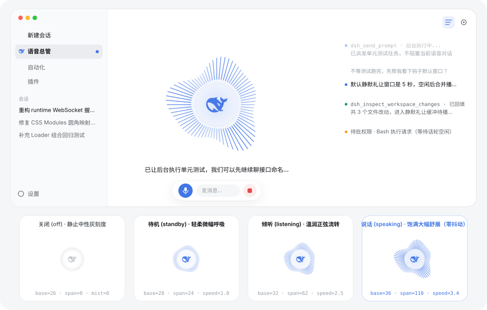
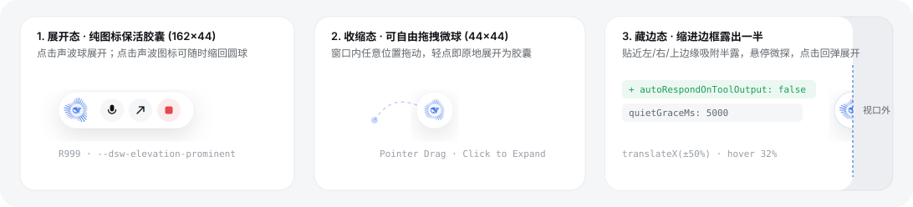

# Agent Note: 客户端全局舞台、浮层胶囊与设置页（Client UI Stage & Settings）

Status: proposed

## 问题

在[全局语音总管架构](2026-11-11-design-philosophy.md)、[语音运行时适配层](2026-11-11-voice-runtime-adapter.md)、[DSH 桥接工具注册表](2026-11-11-voice-tool-registry.md)与[事件钩子与话轮礼让缓冲](2026-11-11-event-hook-engine.md)之上，浏览器与桌面端 GUI 需要承载全双工边聊边干语音交互、跨会话保活导航与插件配置管理，若缺乏严谨的客户端架构与原生视觉融合约束会引发四类问题：

- **面板切换打断实时语音流**：DSH 主区域 `main` 是按面板 key 互斥切换的视图槽位；若把 WebSocket 连接、麦克风采集或 `AudioContext` 生命周期绑死在主舞台 React 组件挂载周期上，用户一旦切回代码会话查看文件改动，语音连接就会断开或丢失挂起确认。
- **自创视觉语言与冗余控件破坏宿主整体感**：若引入非原生深色卡片框、多色跳变波纹、模式切换器、会话切换下拉框，或改动宿主既有 UI 文案、在窄宽度下让中文折成竖排单字列，都会同 DSH 极简克制的原生工作台风格产生割裂。
- **固定浮层遮挡代码阅读与硬件资源泄漏**：跨会话浮层若无法收缩、移动或贴边避让，容易遮挡代码 Diff 右上角区域；而实时语音在打断、静音、多窗口接管（`ownerEpoch`）与插件停用时若不能精确回报播放排空水位或彻底关闭 `MediaStreamTrack`，会导致钩子抢话或系统录音指示灯常亮泄漏。
- **手写配置表单偏离原生插件详情页规范**：语音模型（`Qwen-Audio 3.1 Realtime Flash / Plus`）、凭据引用与运行策略支持 `.volatile()` 热更新，若脱离宿主「插件」二级详情页（`plugins.bundle.config`）与共享 `<SettingsForm>` 原语另起炉灶，既侵入全局设置结构又难以保证多端修订一致性。

## 提案

在 `@whyself/ttds/client` 中实现零模块单例的客户端控制器 `TtdsClientController`，100% 融入 DSH 原生样式且**绝不修改宿主任何已有 UI 文案**，向 DSH 公开客户端插槽注册四处极简协同界面：左上角全局导航入口（`sidebar.panellist`）、采用单色四态去实心放大核心声波环与旁侧无边框渐隐事件流的语音总管主舞台（`main`）、支持缩成微球自由拖拽并可缩进窗口边框露出一半的跨会话保活精灵（`shell.overlay`），以及落位在 DSH 原生「插件」二级详情页的多提供方可扩展配置界面（`plugins.bundle.config`）。

## 客户端打包、模块挂载与原生融合总则

### `dsh.client` 清单、品牌图标与详情海报声明

- **导出与清单声明**：`packages/ttds/package.json` 导出 `"./client"`（指向 `./lib/client.js` 与 `./lib/types/client/index.d.ts`），声明 `dsh.client` 为 `{ "platform": "web", "inject": ["@deepseek-ai/dsh-client-ui-layout", "@deepseek-ai/dsh-client-ui-sidebar", "@deepseek-ai/dsh-client-ui-session", "@deepseek-ai/dsh-client-ui-settings", "@deepseek-ai/dsh-client-ui-plugin-manager"] }`（其中 `ui-settings` 仅用于读取 `ctx.configForms` 与 `ctx.settingsSchema` 服务，不向全局设置弹窗注入顶层导航分区）。
- **包图标与详情页横向预览海报**：`packages/ttds/package.json` 顶层声明 `"icon": "./icon.svg"` 并将 `"icon.svg"`、`"docs"` 与 `"locale"` 列入 `"files"`——插件包卡片及详情页头部 `44×44` 图标框渲染带 Talk 双向对话气泡与律动声波元素的 `36×36` 官方蓝青渐变图标（初稿见 [plugin-icon-talk.svg](assets/plugin-icon-talk.svg)，以 `<mask>` 挖出亮暗主题通用的透明叠层呼吸间隙，与单向录音转写图标一眼区分）；`locale/zh.json` 与 `locale/en.json` 的 `meta.detail` 分别指向精简详情文档 `docs/DETAIL.zh.md` 与 `docs/DETAIL.md`，内含单幅 `640×300` 横向功能预览海报（初稿见 [plugin-banner-preview.svg](assets/plugin-banner-preview.svg)），由宿主 `@deepseek-ai/dsh-util-plugin-detail` 优先加载渲染于设置表单上方，避免将面向开发者的长篇 `README.md` 铺入二级详情页顶部。
- **裸包名挂载与惰性 CJS 隔离**：遵循 `@deepseek-ai/dsh-client-modules` 仅将 `./client` 挂接在说明符为裸包名的根 Loader 条目上的契约，`cordis.patch.yml` 以根行 `id: ttds`、`name: '@whyself/ttds'` 下发客户端产物；构建输出向 `window.__ModuleLoader__.load({ id: '@whyself/ttds', factory })` 注册惰性 CJS 闭包，CSS Modules 样式在插件停用时随客户端模块系统完整回收。

### 零单例控制器、原生排版省略与本地化约束

- **实例级状态持有**：`apply(ctx)` 在客户端插件 fiber 内创建唯一的 `TtdsClientController` 并通过 `ctx.effect()` 托管异步销毁，内部持有 `/api/ttds/realtime` WebSocket 句柄、带单调媒体世代令牌的 Web Audio 采集播放管线、最近 200 条事件流镜像以及按 `uiConfirmId` 保序排列的挂起 `'ui'` 确认队列，不声明任何模块级单例或全局变量。
- **纯净宿主文案与极简图标融合**：严禁修改或覆盖 DSH 宿主任何已有侧栏、顶栏或插件管理文案；总管界面不设模式切换组件与后台会话切换器，减少文字标签并以语义化矢量图标融入整体；所有单行文本与弹性子项一律遵循 DSH 默认省略规范（容器 `min-width: 0`，文本节点 `overflow: hidden; text-overflow: ellipsis; white-space: nowrap`），绝不在窄视口下挤压成竖列；插件自有提示与无障碍名称全部经 `ctx.locale.register('ttds', dictionaries)` 本地化。

## 全局导航入口、极简主舞台与四态声波设计

### 左上角全局导航入口（`sidebar.panellist`）

通过 `ctx.slots.inject('sidebar.panellist', ...)` 注册全局面板入口（`id: 'ttds' as MainPanelId`），遵循侧边栏 32px 展开行高与 36px 折叠窄轨几何，渲染 16px 双线重小鲸鱼声波图标、支持单行省略的本地化名称及尾部 `StateDot`（仅在通话活跃或存在待处理确认时显示），点击调用 `ctx.layout.selectPanel('ttds')` 切换主区域而不改动后台当前选中的代码会话。

### 语音总管极简主舞台与四态声波核心（`main`：`key: 'ttds'`）

主面板遵循 [Web UI 样式参考](../../../../docs/web-styling.md)、[DSH 统一圆角规范](../../../../docs/ui-radius.md) 与窗口标题栏避让变量（`--dsh-frame-top-clearance`、`--dsh-frame-leading-clearance`），采用无外框束缚的柔和留白画布：

1. **单色四态去实心声波核心**：
   - **去实心与无外波纹几何**：不设实心圆底与外围扩散波纹圈，在 `600×600`（2x DPR，CSS `300×300`）画布中心稳态放置放大的原生 `FishLogo`（基准宽 `108`）、柔和径向微雾光晕、极细内导轨环（`R=108`）以及 72 根圆头径向声谱针（内起点基准 `R=122`，线宽 `2.4`）。中心 `FishLogo`、内导轨环与背景光晕保持平稳居中，无歪头摇晃与高频振幅抽动。
   - **统一单色语义 Token 不跳色**：Canvas 渲染不硬编码明暗字面量分支，统一经 `getComputedStyle` 读取宿主语义 Token（激活态 `待机`、`倾听`、`说话` 消费 `--dsw-alias-state-business-primary`，`关闭` 态消费 `--dsw-alias-label-tertiary`，内导轨细环消费 `--dsw-alias-border-l2`）并订阅 `ctx.theme` 主题变更实时刷新缓存色值，状态切换不发生彩色跳变。
   - **四态连续正弦流转参数**：72 根声谱针共用 360° 三阶复合正弦包络与连续相位积分 `wavePhase += dt * speed`（切换速度时线性插值、绝不跳帧）：
     - **`关闭 (off)`**：`baseLen = 26, deltaSpan = 0, innerPush = 0, mist = 0`（静止中性灰刻度）；
     - **`待机 (standby)`**：`baseLen = 28, deltaSpan = 24, innerPush = 2.5, speed = 1.0, mist = 0.09, mistR = 142`（轻柔低幅慢速流转）；
     - **`倾听 (listening)`**：`baseLen = 32, deltaSpan = 62, innerPush = 6.3, speed = 2.5, mist = 0.13, mistR = 156`（温润中幅正弦流转）；
     - **`说话 (speaking)`**：`baseLen = 36, deltaSpan = 110, innerPush = 12.0, speed = 3.4, mist = 0.20, mistR = 188`（饱满大幅向外舒展流转，与 `倾听` 层次分明且丝滑平稳）。
   - 系统启用 `prefers-reduced-motion: reduce` 时停止相位推进，降级为静态四态幅度与柔和透明度过渡。
2. **旁侧无边框渐隐流式事件流**：
   - 右上角纯图标开关控制舞台右侧浮现**无边框、上下线性渐隐遮罩（`mask-image`）的轻量事件流**，按时间序柔和滚动呈现单行省略的用户转写、助手口语短句、后台非阻塞异步工具进度（边聊边干执行中 / 已回填待播）及事件钩子提醒。
3. **底部纯图标融合控制坞与按需引导**：
   - 底部悬浮紧凑胶囊控制坞（`border-radius: 999px; corner-shape: round; border: 0; box-shadow: var(--dsw-elevation-soft)`），集成正圆麦克风启停/静音图标按钮（`border-radius: 50%; corner-shape: round`）、支持 IME `observeComposition` 保护的紧凑文字直输框与挂断图标按钮；右上角设置齿轮图标直达 `ctx.pluginNavigation.openBundle('@whyself/ttds')`。
   - 未配置凭据时在中央展示紧凑引导入口跳转「插件」二级详情页；遇到多窗口 `already_active` 或队列头存在挂起 `'ui'` 工具确认请求时，在控制坞上方浮现原生 `R20` 轻量操作卡。

## 跨会话可伸缩声波胶囊与贴边半露微球（`shell.overlay`）

当用户切回 `conversation` 代码会话或其他面板，且**当前窗口持有活跃 `(connId, ownerEpoch)` 语音会话控制权**时，`shell.overlay`（`id: 'ttds.floating-pill'`）自动呈现可自由变形与移动的浮层精灵（非控制权的只读页签不渲染控制胶囊）：

- **胶囊 ⇄ 微球双向伸缩**：展开态为 `162×44` 纯图标柔和胶囊（遵循独立浮层材质规范使用 `border-radius: 999px; corner-shape: round; border: 0; background: var(--dsw-specific-menu); box-shadow: var(--dsw-elevation-prominent)`，确保 macOS 等环境下不透出底层代码文字），仅含左侧 32 针浓缩动态小鲸鱼声波图标及麦克风静音、返回主舞台、挂断三枚纯图标按钮；点击声波图标即可沿弹簧曲线（`cubic-bezier(0.22, 1, 0.36, 1)`）收缩为 `44×44` 正圆动态声波微球（`border-radius: 999px; corner-shape: round`），再次点击微球即原地展开为胶囊。
- **窗口内任意拖拽与缩进边框露出一半（Edge-Tucked Half-Peek）**：微球支持指针拖拽移动至工作台任意位置（限制在窗口安全视口内并避让 `--dsh-frame-overlay-top`）；松手时若贴近左、右或上侧窗口边缘（阈值 `28px`），自动吸附边缘并**缩进窗口边框仅露出一半圆弧**（`translateX(±50%)` / `translateY(-50%)`），指针悬停时轻柔探出至 `32%`，点击展开胶囊时自动完整滑回视口内，实现零遮挡代码阅读与后台语音伴随。
- **跨会话 `'ui'` 确认队列气泡**：当后台异步工具发起 `'ui'` 确认时，按 `uiConfirmId` 队列顺序在精灵旁侧浮现紧凑确认气泡（用户在开口向语音总管追问操作细节时气泡保持常驻不误关），支持边看代码 Diff 边一键点击批准或拒绝。

## Web Audio 媒体管线、水位确认与客户端委托闭环

- **采集播放解耦、硬件设备绑定及带世代令牌的零残留释放**：控制器监听 `navigator.mediaDevices` 的 `devicechange` 事件动态刷新本机 `audioinput` / `audiooutput` 设备目录（已选设备拔出时自动回退系统默认设备），采集请求按所选 `inputDeviceId` 传递精确约束，下行播放 `AudioContext` 在支持 `setSinkId` 的运行时绑定所选 `outputDeviceId`。每次请求 `getUserMedia` 或 `audioWorklet.addModule` 均绑定单调递增的 `mediaGeneration` 并登记至控制器待结算集合（若异步 resolve 时已静音、挂断、收到 `session.replaced` 或控制器已销毁，立即同步调用 `.stop()` / `await close()` / `revokeObjectURL` 杜绝迟到授权泄漏）。点击麦克风静音时立即停止 16kHz 上行分片并释放上行采集 `MediaStreamTrack`（熄灭录音灯），**同时保留下行播放 `AudioContext`** 以继续收听边聊边干的语音回复与文字输入续答；当收到 `session.replaced`（控制权被其他窗口接管）或连接异常断开时，立即停止全部 `MediaStreamTrack` 并清空播放缓冲；当用户主动挂断会话或客户端插件 `dispose()` 时，停止 Worklet、终止全部 `MediaStreamTrack` 并等待 `await AudioContext.close()` 彻底释放硬件资源。
- **24kHz 下行播放与单调渐进水位回报（`playback.drained`）**：按 `(turnGeneration, responseId, audioSeq)` 顺序播放下行音频并丢弃过期代际帧；收到 `playback.clear` 或 `session.replaced` 时 10ms 内清空播放队列；每当某个响应的末帧或当前已入队缓冲播放完毕时，上报 `{ type: 'playback.drained', connId, ownerEpoch, turnGeneration, upToAudioSeq }`，配合 Host 侧上游音频终结门控精确驱动话轮静默计时。
- **客户端委托执行器**：响应 Host 纪元委托请求读取 `ctx.uiSession.sessionStatus.getSnapshot()`、执行焦点会话切换，并在 `dsh_resolve_interaction` 中调用公开的 `PendingApproval.answer()` / `PendingQuestion.answer()` 与宿主原生会话卡片同步结算。

## 「插件」二级详情页设置界面与多提供方扩展方案（`plugins.bundle.config`）

遵循零侵入顶层设置与**无必要不自创控件**的原则，TTDS 的配置界面唯一挂载在 DSH 原生「插件」管理器的二级包详情页（`PluginManagerPage` -> `@whyself/ttds` `PackageDetail`：顶部展示 `44×44` 框内的 `icon.svg` Talk 渐变彩标与标题旁 `plugins.detail.badge` 凭据状态 `<Tag>`，其下由宿主原生 `<BundleDetailSection>` / `<DetailDocument>` 上下 `0.5px` 分割线容器渲染 `meta.detail` 指向的 `640×300` 横向功能预览海报，紧接在下方 `plugins.bundle.config` 插槽渲染配置表单）：

- **100% 对齐 DSH 官方原生插件设置样式**：不在 `plugins.bundle.config` 内重复自创海报或外层卡片框、自定义滑杆，直接衔接宿主 `<DetailDocument>` 横向海报下方，全页共用单一无外框 `<SettingsForm>`（底部仅一枚在脏且合法时激活的原生墨色「保存」按钮，离开页面自动 `onDiscard` 丢弃草稿）；内部仅使用宿主官方内置设置页现成的五种原语模式——`<SettingsSecretField>`、`<SettingsValueField>`（含 `?` 内联帮助展开、`已修改` `Tag` 与 `重置` 按钮，口语提示词复用同款头部与边框 Token 渲染多行 `<textarea>`）、复刻 `WebSearchCard` 的全宽 `<Menu>` 选择器加浅灰圆角联动面板 `.panel`（`--dsw-alias-bg-module-platform`）、复刻 `SubagentModelSelectionFields` 的 `<Switch>` 开关行，以及复刻 `PermissionRow` 的单行细线紧凑 `<Menu>` 选择行。
- **分区一：语音服务与模型（可扩展多提供方选择器 + 提供方专属 `.panel`）**：
  - 顶部渲染全宽 `ProviderSelect` `<Menu>` 下拉菜单（订阅 `ttdsRuntime` 已注册提供方列表，首版默认选中 `阿里云百炼 · Qwen-Audio Realtime`，后续新增或第三方扩展的实时语音提供方自动出现在同一选择器中），下方联动切换所选提供方专属的浅灰 `.panel` 配置面板。
  - 选中 `qwen-realtime` 时，`.panel` 内展示其专属字段：百炼 API 密钥（`apiKey`，`<SettingsSecretField>` 走 `ctx.remote.credentials` 安全写入不回显密文）、业务空间 ID（`workspaceId`，`<SettingsValueField>`）、实时语音模型（`model` `<Menu>`：`Qwen-Audio 3.1 Realtime Flash` 默认 / `Qwen-Audio 3.1 Realtime Plus`）、合成音色（`voice` `<Menu>` 默认 `longanqian_v3.1`，选「自定义音色 ID」展开输入框）、合成语速（`speechRate` `<SettingsValueField numeric>`，默认 `1.0`，范围 `0.5 ~ 2.0`；情感韵律内部默认开启，模型黑盒 `enable_search` 内部固定关闭）、话轮判停方式（`turnDetection` `<Menu>`：`smart_turn_v2` 默认 / `server_vad` / `manual`，前两者显示 `-1.0 ~ 1.0` 的 `vadThreshold` 默认 `0.5`，仅 `server_vad` 额外显示 `200 ~ 2000` ms 的 `silenceDurationMs` 默认 `800`）、保留上下文轮数（`maxHistoryTurns` `<SettingsValueField numeric>`，默认 `10`），以及默认折叠在原生 `高级连接选项 ⌄` 下的自定义接入地址（`endpoint`）。
- **分区二：音频设备与通用交互（跨提供方通用）**：依次排布麦克风输入设备（`inputDeviceId` `<Menu>`，默认跟随系统麦克风，枚举浏览器 `audioinput`）、扬声器输出设备（`outputDeviceId` `<Menu>`，默认跟随系统扬声器，枚举 `audiooutput`，不支持 `setSinkId` 时置灰说明）、连接后默认闭麦（`startMuted` `<Switch>`，默认关闭），以及自定义口语提示词（`customInstructions` 多行输入框，点击 `?` 可展开查看只读内部预置提示词摘要，修改后支持一键 `重置`，运行时与内部预置提示词自动合并生效）。
- **分区三与分区四：DSH 桥接工具与事件钩子（跨提供方通用，底层工程参数不外露）**：
  - **DSH 桥接工具**：按 `PermissionRow` 细线列表列出 11 项核心内置工具（`dsh_list_sessions`、`dsh_read_session_messages`、`dsh_inspect_workspace_changes`、`dsh_read_workspace_file`、`dsh_list_pending_interactions`、对接 `ctx.web` 的联网搜索 `dsh_search`、`dsh_focus_session`、`dsh_create_session`、`dsh_send_prompt`、`dsh_control_execution`、`dsh_resolve_interaction`）及动态扩展工具，向写操作提供 `弹窗确认` / `自动执行` 两档切换。
  - **事件钩子与话轮礼让**：顶部为话轮静默礼让时长（`quietGraceMs` `<SettingsValueField numeric>`，默认 `5000` ms），下方按 `PermissionRow` 列出 5 项宿主生命周期钩子（`dsh_approval_requested`、`dsh_question_requested`、`dsh_turn_failed`、`dsh_turn_completed`、`dsh_job_settled`），右侧紧凑 `<Menu>` 提供 `主动播报` / `静默记入` / `已禁用` 三档切换。内部系统续答钩子 `ttds_tool_output_ready` 及 `maxOutputChars`、`uiConfirmationTimeoutMs`、`maxBufferedEvents`、`maxBatchChars`、单条 `description` 覆写等底层工程阈值不在图形界面露出，仅保留在 `cordis.patch.yml` 配置层。

## 考虑过的替代方案

**向 DSH 全局「设置」居中弹窗（`settings.section`）额外注入独立「语音」分区，或同时维护两套设置入口。** 落选原因：将插件专属配置收敛在原生「插件」二级详情页（`plugins.bundle.config`）完全契合宿主插件管理心智，既零侵入顶层全局设置导航，又免去维护双入口样式同步。

**采用实心中心圆球、外圈扩散波纹、多状态变色，或给 `倾听`/`说话` 叠加高频音节缩放抖动。** 落选原因：实心圆底厚重死板，外圈波纹与跳色喧宾夺主，而高频振幅调制与中心图标摇晃会产生视觉抖动疲劳；采用去实心微雾光晕、稳态放大的原生 `FishLogo` 与无外波纹单色四态连续正弦声谱针，在保持 `倾听` 温润质感的同时仅靠平滑大幅度舒展拉开 `说话` 区分度，最柔和耐看。

**采用带边框固定侧栏展示事件流，或使用不可变形、不可藏边的固定浮层胶囊。** 落选原因：重边框抽屉割裂主舞台呼吸感，固定胶囊在阅读代码时易遮挡右上角内容；改用无边框上下渐隐事件流以及可缩成球、任意拖拽并可缩进边框露出一半的浮层精灵，兼顾信息透明与极简无遮挡。

**把语音连接与 Web Audio 管线挂在 `main` 舞台 React 组件内部。** 落选原因：`main` 面板随路由互斥卸载，将连接与媒体管线收归插件 fiber 级 `TtdsClientController` 配合 `shell.overlay` 浮层精灵才能保证跨会话不断连。

## 验收标准

- **构建与客户端模块加载验证**：`pnpm run build` 产出符合 `dsh-client-modules` 惰性 CJS 工厂规范的 `lib/client.js`；通过真实 Loader 组合测试验证侧边栏入口、`main` 极简舞台、`shell.overlay` 可伸缩声波精灵及「插件」二级详情页 `plugins.bundle.config` 正常挂载且零改动宿主既有文案。
- **四态声波、球⇄胶囊贴边半露与单行省略验证**：验证 `关闭`、`待机`、`倾听`、`说话` 四态平滑连续过渡且无高频抖动与跳色；验证浮层胶囊点击缩成 `44×44` 微球、任意拖拽、贴近左/右/上边缘缩进露出一半、悬停微探与点击回弹展开；窄视口下所有单行文本均以 `...` 省略截断而不折成竖列。
- **边聊边干保活、硬件零残留释放与 `doc-sync` 门禁**：开启语音后切换代码会话不断连，后台异步工具运行与 `'ui'` 确认队列气泡在跨会话说话讨论期间正常工作；静音后断言上行 `MediaStreamTrack.readyState === 'ended'` 且下行播放 `AudioContext` 仍正常发声；收到 `session.replaced` 断言旧窗口 `MediaStreamTrack` 立即终止；挂断、飞行中 `getUserMedia` 取消或停用插件后断言全部 `MediaStreamTrack.readyState === 'ended'` 且 `AudioContext.state === 'closed'`；全仓文档、初稿矢量资产链接与界面字典通过 `pnpm run doc-sync`。

## 风险

- **浏览器自动播放与首次麦克风授权手势要求**：Chromium 与桌面 WebView 要求首次 `getUserMedia` 与 `AudioContext` 恢复发生在用户点击调用链内；因此插件加载后默认处于 `关闭 (off)` 态，由用户点击主舞台或浮层按钮显式发起会话。
- **窗口尺寸动态缩放时的贴边坐标重算**：用户拖拽缩放浏览器或桌面窗口尺寸时，贴边半露或自由停靠的微球可能超出新视口边界；需监听窗口 `resize` 将微球坐标实时钳制回新视口安全边缘并保持原贴边吸附侧。
