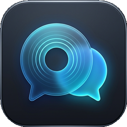

<p align="center">
  
</p>

<h1 align="center">Talk to DeepSeek (TTDS)</h1>

<p align="center">面向 DeepSeek Harness（DSH）的拟人化全双工实时语音监督插件包。</p>

<p align="center">
  <a href="https://github.com/deepseek-ai/deepseek-harness"></a>
  <a href="https://www.npmjs.com/package/@whyself/ttds"></a>
  <a href="packages/ttds/package.json"></a>
  <a href="https://nodejs.org/"></a>
  <a href="LICENSE"></a>
</p>

## 目录

[简介](#简介) · [功能一览](#功能一览) · [前置要求](#前置要求) · [安装与启动](#安装与启动) · [安全边界](#安全边界) · [仓库结构](#仓库结构) · [开发与验证](#开发与验证) · [文档与致谢](#文档与致谢)

## 简介

[DeepSeek Harness（DSH）](https://github.com/deepseek-ai/deepseek-harness) 提供了会话运行时、工作区工具与插件加载体系。TTDS（`@whyself/ttds`）在此基础上以独立插件包形式接入实时全双工语音对话能力：用户在网页端用口语或文字与语音助手自然交谈时，助手通过受控工具查看工作区 Git 改动、查询多个后台会话进展、向已有会话插话纠偏、触发联网检索并协同处理工具审批，同时监听后台会话生命周期事件，在双方静默后口语播报进展。

所有能力均只通过 `@deepseek-ai/*` 公开扩展点、Cordis 服务与 `cordis.patch.yml` 组合实现，不修改 DSH 宿主源码。当前发布版本为实验性预发布版 **`0.1.0-alpha.1`**，适配 DSH `>=0.2.2-alpha.3 <0.3.0-0`（基线验证版本 `0.2.2-alpha.3`）。

<p align="center">
  
</p>

## 功能一览

- **全双工口语舞台与跨页悬浮微球**：在专用侧栏面板提供四态（休眠、思考、聆听、说话）呼吸声波舞台与渐隐事件流，支持浏览器 `16kHz` PCM16 麦克风采集、`24kHz` PCM 流式播放、随时打断清队（barge-in）、闭麦启动及无麦克风环境下的文字输入驱动；切回编码会话时舞台退化为可拖拽、可贴边半露的悬浮微球。
- **持久化文本审计与断连上下文恢复**：实时会话的输入文本、转录、工具调用/回填和后台提醒均脱敏写入本地 JSONL 日志（绝不落盘原始 PCM 音频或 API Key）；连接关闭或空闲超时后重开新会话时，服务端自动从历史日志读取最近有界对话与后台操作记录，以系统上下文静默恢复而不触发主动复述。
- **11 个受控 DSH 桥接工具**：涵盖会话列表、进度总结、工作区 Git 状态/差异、消息读取（自动过滤多步工具中间草稿并附带首条任务）、挂起审批查询、宿主联网检索代理（`dsh_search`，并强制关闭语音模型原生搜索）、新建会话、立即插话/排队追问（`steer` / `queue`）、回合取消、模型切换与审批决议。
- **两档确认门禁与防回声抑制**：只读与联网工具自动执行，会话写控制工具默认弹窗确认（`ui`，可在插件详情页实时切换为 `auto` 且支持配置保存不中断通话），审批决议固定弹窗确认；同步写操作执行期间通过 `beginSelfAction` 抑制同源事件重复播报。
- **礼让式后台事件钩子**：监听 `session/event` 与 `ttds/lifecycle-event`，收集根/子代理回合完成、权限审批与向用户提问（`ask_user_question`）、Agent 错误与命令非零退出，按去重键与优先级合并，仅在用户与模型回到静默后唤醒播报并附带关联 `sessionId` / `approvalId`。
- **可插拔运行时与服务商**：默认内置阿里云百炼 Qwen-Audio 3.1 Realtime 适配器（`qwen-audio-3.1-realtime-flash` / `qwen-audio-3.1-realtime-plus`），支持 `smart_turn_v2` / `smart_turn` / `server_vad` / `push_to_talk` 判停；其他插件可通过公开扩展点注册自定义语音服务商、语音工具和钩子事件源。

## 前置要求

- Node.js `^22.19.0 || >=24.0.0`
- 已安装并可用的 DeepSeek Harness（`>=0.2.2-alpha.3 <0.3.0-0`）
- 阿里云百炼 DashScope API Key（通过环境变量 `DASHSCOPE_API_KEY` 传入，或在 DSH 插件设置页中保存；如使用专属业务空间可一并设置 `DASHSCOPE_WORKSPACE_ID`）
- Web 客户端麦克风采集与指定输出设备（`AudioContext.setSinkId`）依赖浏览器安全上下文（`localhost` 或 `https:`）；无麦克风授权时仍可闭麦收听并通过输入框文本交互

## 安装与启动

在已安装 DSH 的环境中安装预发布包 `@whyself/ttds@alpha` 到目标 profile（例如 `web`）：

```sh
dsh plugin --profile web add @whyself/ttds@alpha
```

如需在宿主机通过环境变量提供凭据并启动 DSH Web 服务：

```powershell
# PowerShell
$env:DASHSCOPE_API_KEY = '<your-dashscope-api-key>'
dsh --profile web
```

```sh
# Bash
export DASHSCOPE_API_KEY='<your-dashscope-api-key>'
dsh --profile web
```

也可先启动 `dsh --profile web`，在页面左侧进入 **插件 → Talk to DeepSeek** 详情页填写 API Key、音色、判停模式、补充提示词与写工具确认策略，保存后即时生效。完整配置字段、工具列表及对模型提示词/上下文与 KV Cache 的影响见 [packages/ttds/README.md](packages/ttds/README.md#配置)。

## 安全边界

- **单用户受控使用**：TTDS 服务于本地或自托管的个人 DSH 实例；请勿将未加鉴权保护的 DSH Web 服务直接暴露到公网。
- **工具授权收敛**：除 5 个只读工具与宿主搜索代理 `dsh_search` 外，会话写操作默认需经网页确认卡片点击允许，工具审批决议固定要求用户显式确认；请仅在完全信任当前语音环境与指令来源时再切换为自动执行（`auto`）。
- **凭据脱敏与最小记录**：API Key 只在服务端读取与注入握手请求头，前端快照仅接收 `hasApiKey` 与 `apiKeySource` 状态；`SupervisorSessionJournal` 自动剔除密钥字段与原始音频数据。

## 仓库结构

```text
TTDS/
├─ packages/ttds/   可独立安装的 @whyself/ttds bundle（runtime、tools、hooks、Web UI 客户端、cordis.patch.yml 与 locale）
├─ docs/            跨包文档规范与 DSH Web UI 样式/圆角/原子组件参考
├─ scripts/         代码卫生门禁（hygiene）、文档门禁（doc-sync）与真实 Loader 组合测试辅助
└─ .agents/         长期有效的架构决策笔记（Agent Notes）与仓库协作 skills
```

## 开发与验证

本仓库使用 pnpm workspace 与 ESM TypeScript：

```sh
pnpm install
pnpm run lint
pnpm run typecheck
pnpm run build
pnpm run hygiene
pnpm run doc-sync
pnpm run test
```

- 在独立 `DSH_HOME` 中验证真实安装与配置层组合：

```sh
pnpm -C packages/ttds pack --out package.tgz
dsh plugin --profile verify add ./packages/ttds/package.tgz
dsh --profile verify --dump-config
```

- 端到端语音链路测试文件位于 [packages/ttds/tests/e2e/text-simulated-voice.e2e.spec.ts](packages/ttds/tests/e2e/text-simulated-voice.e2e.spec.ts)：常规运行覆盖全栈伪上游测试，当环境中存在 `DASHSCOPE_API_KEY` 时额外执行阿里百炼 Realtime 实网用例（未设置密钥时自动跳过该条）。

## 文档与致谢

- [packages/ttds/README.md](packages/ttds/README.md)：`@whyself/ttds` 安装配置表、桥接工具细则、模型体验（Prompt/Token/KV Cache 审计）与已知限制。
- [AGENTS.md](AGENTS.md) 与 [docs/AGENTS.md](docs/AGENTS.md)：插件解耦边界、编码要求与文档分层规范。
- [.agents/notes/README.md](.agents/notes/README.md)：设计提案与架构决策记录（含[总体设计理念](.agents/notes/proposed/architecture/2026-11-11-design-philosophy.md)、[语音运行时与适配器](.agents/notes/proposed/architecture/2026-11-11-voice-runtime-adapter.md)、[语音工具注册表](.agents/notes/proposed/architecture/2026-11-11-voice-tool-registry.md)、[事件钩子引擎](.agents/notes/proposed/architecture/2026-11-11-event-hook-engine.md)与[客户端舞台设计](.agents/notes/proposed/architecture/2026-11-11-client-ui-stage.md)）。
- 致谢 [DeepSeek Harness（DSH）](https://github.com/deepseek-ai/deepseek-harness) 提供的插件化运行时与界面插槽体系，以及阿里云百炼 Qwen-Audio Realtime 实时语音模型服务。

## License

[MIT](LICENSE)
